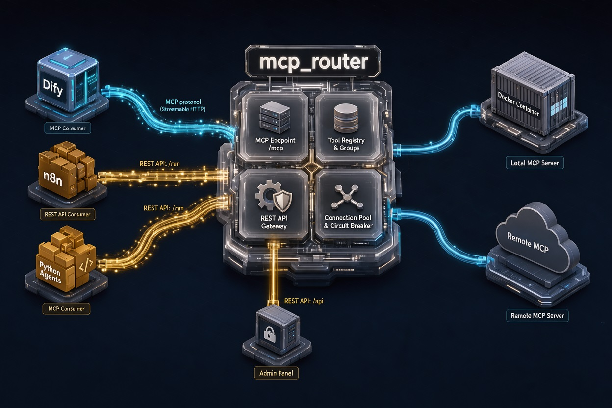
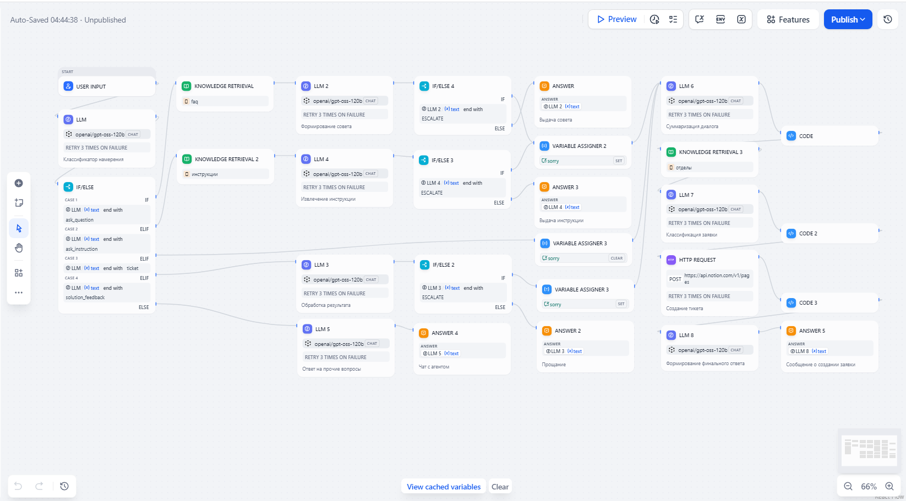
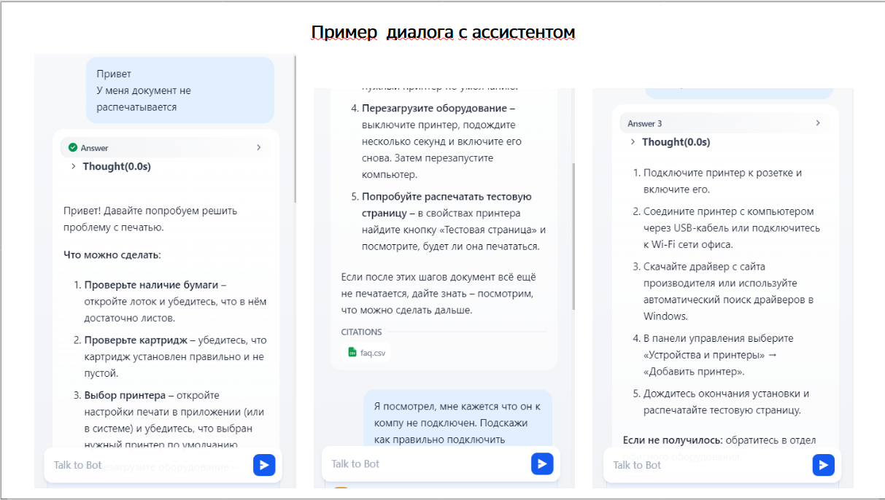
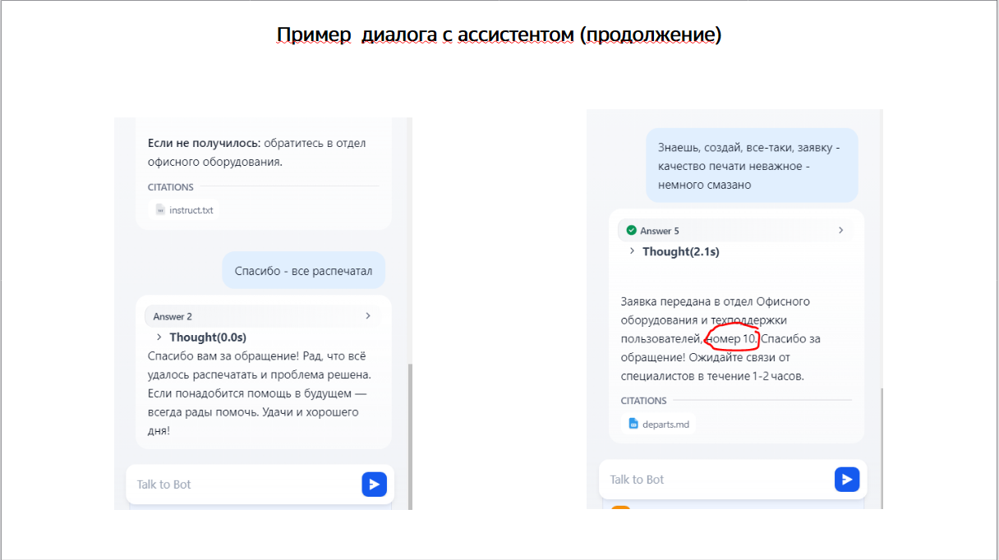
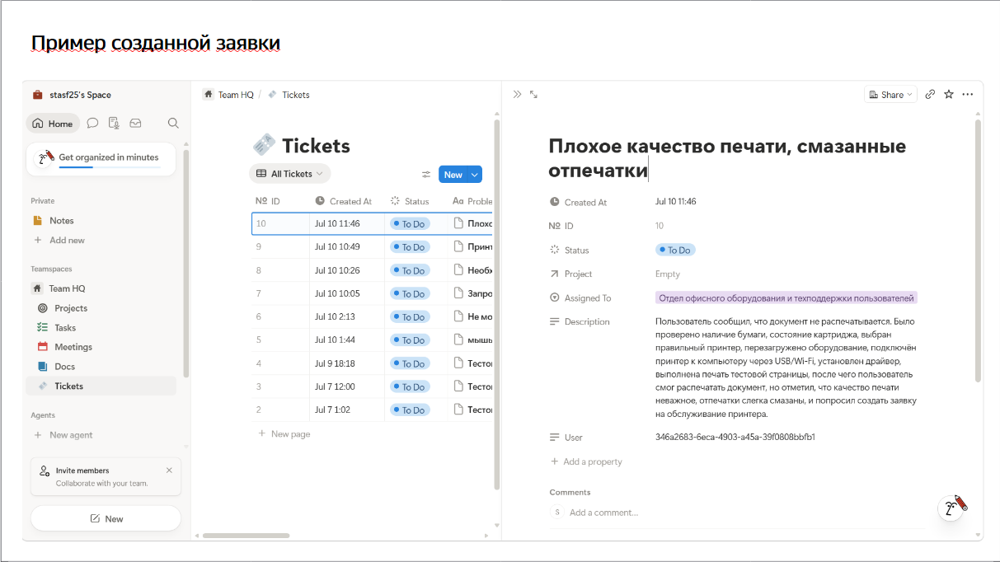
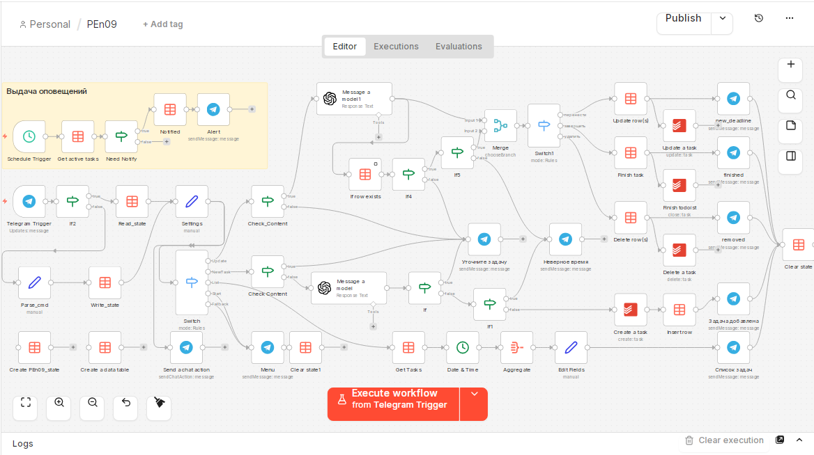
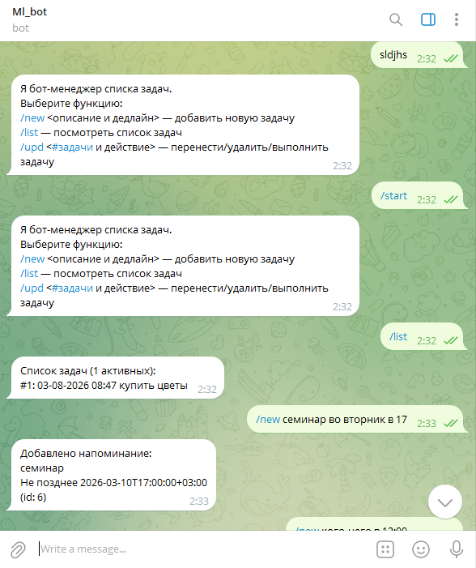
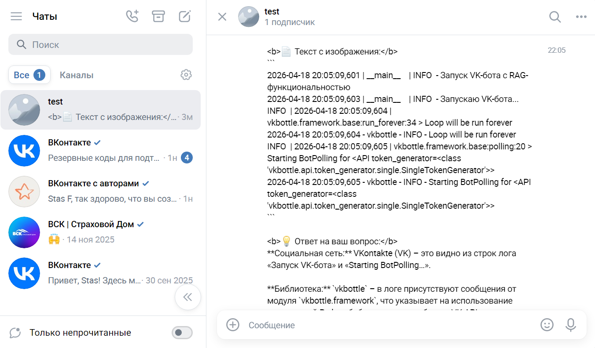

# Привет! Меня зовут Станислав 👋

Я ML/DL и Prompt-инженер с фокусом на создание практических AI-решений: LLM-агентов, умных помощников и систем работы с базами знаний. 

Моя главная цель — превращать сложные технологии в простые и удобные инструменты, которые решают реальные бизнес-задачи. За плечами более 20 реализованных проектов, два диплома Яндекс.Практикума (ML и DL/NLP) и многолетний опыт в сфере экономики и финансов. Я понимаю не только *как* сделать, но и *зачем* это нужно бизнесу.

---

## 🛠️ Мои ключевые навыки

- **Искусственный интеллект:** LLM-агенты, RAG (семантический поиск), промпт-инжиниринг, классический ML, дообучение нейросетевых моделей.
- **Разработка:** Python, создание Telegram/VK-ботов, REST-API, работа с векторными базами данных.
- **Low-code и автоматизация:** Работа с **n8n** и **Dify** для быстрого создания и интеграции AI-воркфлоу.
- **Инфраструктура:** AirFlow, MLflow, контейнеризация, базовый мониторинг (Prometheus/Grafana).

---

## 🚀 Некоторые проекты

Здесь собраны проекты, которые показывают мой подход: от идеи до работающего решения. 

### 🌐 [mcp_router: Контейнеризированный шлюз для MCP-инструментов](https://github.com/stasf25/mcp_router)

- **Какую задачу решает:** Агрегирует инструменты с нескольких downstream MCP-серверов (например, Playwright, BrightData) и предоставляет к ним доступ через единую точку входа (MCP endpoint или REST API) с возможностью группировки и динамической фильтрации AI-инструментов.
- **Стек:** Python, Docker, REST API, экспорт метрик в формате Prometheus (`/metrics`).
- **В чем плюс:**
  - **Оптимизация потребления токенов (до 10×):** Вместо передачи LLM полного списка всех доступных инструментов с объемными JSON-описаниями, роутер предоставляет возможность как статической, так и динамической группировки инструментов, релевантных для конкретного запроса к LLM. Это предотвращает раздувание контекста и снижает затраты на API.
  - **Упрощение интеграции (REST → MCP):** Шлюз предоставляет возможность прямого вызова любого MCP-инструмента через стандартный HTTP-запрос (`/run/tool/call`). Это исключает необходимость реализации полноценного MCP-клиента, обработки JSON-RPC и сложных протоколов рукопожатий.
  - **Готовая совместимость с AI-платформами:** Поддержка self-hosted решений, таких как **Dify**, «из коробки», а также архитектурная совместимость с другими MCP-клиентами по аналогичному принципу.
  - **Адаптивность к версиям протокола MCP:** Поддержка «из коробки» всех версий протокола MCP как на стороне входящих (клиентских), так и исходящих (к downstream-серверам) соединений.

**Визуализация:**

  
Архитектура mcp_router

  

<!--  -->

### 🏗️ [KBS: Сервис управления базой знаний (Knowledge Base Service)](https://github.com/stasf25/kbs)
- **Какую задачу решает:** Предоставляет готовый, безопасный и масштабируемый бэкенд для работы с векторными базами знаний (загрузка документов, семантический поиск, обновление).
- **Стек:** Python (FastAPI), Qdrant, Docker, Prometheus, Grafana, Loki.
- **В чем плюс:** Это production-ready микросервис "из коробки". Он гарантирует строгую изоляцию данных между разными клиентами (мультитенантность), автоматически калибрует точность поиска и имеет встроенную систему мониторинга. Создает фундамент для корпоративных AI-агентов.
<!--  -->

### 🎯 [ИИ-ассистент первой линии техподдержки](#) *(приватный проект)*
- **Какую задачу решает:** Автоматически обрабатывает типовые обращения сотрудников по IT-вопросам.

Сотрудник задаёт вопрос в чат и получает ответ за секунды из базы знаний. 
Когда вопрос нестандартный, бот сам создаёт заявку в Notion с корректной маршрутизацией и кратким резюме диалога.

Бот опирается на три базы знаний: 
- FAQ для быстрых ответов;
- Инструкции для пошаговых действий; 
- Отделы для маршрутизации заявок. 

При создании заявки бот сначала кратко резюмирует диалог  с сутью проблемы, контекстом и тегами. 
Затем по базе знаний «Отделы» определяет маршрут заявки, создаёт страницу тикета в Notion и возвращает номер тикета пользователю.
 
- **Стек:** Технически бот реализован на базе self-hosted платформы Dify со стандартным web-виджетом, который легко интегрируется на внутрикорпоративный сайт.
- **В чем плюс:** Разгружает IT-отдел от рутины. Построен на Dify, что позволило быстро настроить логику без глубокой программирования. Есть полная документация и презентация для внедрения.

**Скриншоты:**

  
Скриншот chatflow в Dify

  

  
Пример диалога

  
  

  
Пример тикета

  

### 🎙️ [Transcriber: ИИ-транскрибатор переговоров](#) *(приватный проект)*
- **Какую задачу решает:** Автоматически переводит аудиозаписи встреч в текст, разделяя реплики по участникам (спикерам) и переводя их при необходимости на русский язык.
- **Стек:** n8n, нейросети для распознавания речи, промпт-инжиниринг.
- **В чем плюс:** Полностью импортозамещенное low-code решение. Экономит часы ручной расшифровки, работает стабильно и не требует сложной настройки серверов.

  
Показать скриншот

  

### 📅 [Planner: Бот-планировщик задач](#) *(приватный проект)*
- **Какую задачу решает:** Помогает пользователям управлять задачами и расписанием прямо в Telegram.
- **Стек:** n8n, Telegram Bot API, промпт-инжиниринг.
- **В чем плюс:** Создан на low-code платформе. Легко масштабируется и адаптируется под новые сценарии без переписывания кода.

  
Cкриншот workflow в n8n

  

  
Cкриншот диалога

  

### 🧠 [RAG-ассистент: Семантический поиск по базе знаний](https://github.com/stasf25/RAG)
- **Какую задачу решает:** Отвечает на вопросы пользователей, строго опираясь на документы из базы знаний. Работает через Telegram-бота и командную строку.
- **Стек:** Python, Chroma (векторная база данных), кэширование запросов, Telegram API.
- **В чем плюс:** Система не выдумывает ответы, а ищет их только в проверенных документах. Кэширование делает ответы на повторные запросы мгновенными без обращения к LLM и расхода токенов.
<!--  -->

### 💬 [Мультимодальный VK-бот](https://github.com/stasf25/vk_bot)
- **Какую задачу решает:** Умный чат-бот для социальной сети ВКонтакте, который понимает не только текст, но и изображения, и может искать информацию в базе знаний.
- **Стек:** Python, VK API, RAG-пайплайн.
- **В чем плюс:** Ведет диалог с пользователем, отвечая на вопросы строго по базе знаний, дает возможность загружать изображения в контекст диалога.

  
Cкриншот диалога

  
  

### 📊 [RECSYS: Рекомендательная система](https://github.com/stasf25/RECSYS)
- **Какую задачу решает:** Предлагает пользователям товары на основе их прошлого поведения.
- **Стек:** Python, Airflow DAG, S3, MlFlow, CatBoost, ALS.
- **В чем плюс:** Использует проверенные, интерпретируемые модели. Регулярное автоматическое дообучение модели (для предотвращения дрифта) без необходимости в гигантских вычислительных мощностях включено в проект "из коробки".

---

- 👤 **Обо мне:** [профиль фрилансера](https://marketplace.zerocoder.ru/zerocoder/21468)
- 📧 **Email:** [stasf25@gmail.com]
- ✈️ **Telegram:** [@Stasf25]
- 🌐 **LeetCode:** [stasf25](https://leetcode.com/u/stasf25/)

*Спасибо, что заглянули! Буду рад вашему фидбеку.* ⭐
